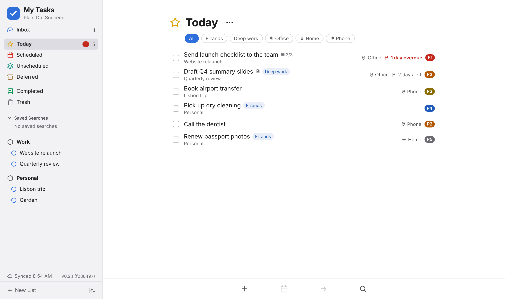

# My Tasks

**Plan. Do. Succeed.**

A better task manager that is **free**, **private** and **secure**. My Tasks gives you the calm, focused way of working that made Things popular, on every device you own, without a subscription, an account with us, or anyone else able to read your list.

> [!WARNING]
> **Work in progress — not ready for real use.** My Tasks is still being built. Features are missing, things will change, and data could be lost between versions. Please don't keep anything important or critical in it yet. You're welcome to try it and follow along.

## Why My Tasks

**Free, for good.** Every feature, on every device, at no cost. No trial, no paid tier, no limits on projects or lists. My Tasks is open source under the MIT license.

**Private by design.** There is no My Tasks server and no My Tasks account. Your list lives on your devices and in your own GitHub account, and nowhere else. No analytics, no tracking, no ads.

**Secure.** Before your list leaves a device, it is encrypted with a passphrase that only you know. The copy in your GitHub account can't be read by GitHub, by us, or by anyone who finds it. Your passphrase is never stored or sent anywhere.

**On every device.** It runs in any modern browser on iPhone, iPad, Mac, Windows, Linux and Android, and installs like an app on each of them. Your list keeps working without a connection, and your devices stay in step whenever they're online.

**Familiar.** Inbox, Today, Scheduled, areas, projects, headings and checklists work the way users expect, with familiar keyboard shortcuts where the browser allows.

## How it compares to other popular task managers

|  | **My Tasks** | **Things 3** | **Todoist** |
| --- | :---: | :---: | :---: |
| **Price** | Free | $49.99 Mac, $19.99 iPad, $9.99 iPhone (each bought separately) | Free for up to 5 projects; paid plan for more |
| Open source | ✅ | — | — |
| Encrypted so only you can read your list (end to end) | ✅ | — ¹ | — ¹ |
| Your data stays in your own account, not the maker's servers | ✅ | — | — |
| No account with the maker needed | ✅ ² | — | — |
| iPhone, iPad and Mac | ✅ | ✅ | ✅ |
| Windows, Linux, Android and the web | ✅ | — | ✅ |
| Works offline | ✅ | ✅ | ✅ |
| Syncs between your devices | ✅ | ✅ | ✅ |
| Five priority levels, with your own names for them | ✅ | — | — ³ |
| Priorities set automatically for due and overdue to-dos | ✅ | — | — |
| Contexts (where or how a to-do gets done) | ✅ | — | — |
| Group Today by project, priority or context | ✅ | — | ✅ |
| Saved searches in the sidebar | ✅ | — | ✅ |
| Inbox, Today and upcoming lists | ✅ | ✅ | ✅ |
| Areas, projects and headings | ✅ | ✅ | ✅ ⁴ |
| Checklists inside a to-do | ✅ | ✅ | ✅ ⁵ |
| Tags | ✅ | ✅ | ✅ |
| Dates and deadlines | ✅ | ✅ | ✅ |
| Deferred (Someday) list | ✅ | ✅ | — |
| Quick Entry, Quick Find and keyboard shortcuts | ✅ | ✅ | ✅ |
| Drag and drop, undo, light and dark themes | ✅ | ✅ | ✅ |
| Repeating to-dos | Planned | ✅ | ✅ |
| Typed dates ("next fri") | Planned | ✅ | ✅ |
| Reminders and notifications | — ⁶ | ✅ | ✅ |
| Calendar, widgets, Siri, Apple Watch | — ⁶ | ✅ | ✅ |
| Sharing lists with other people | — | — | ✅ |

¹ Things and Todoist encrypt your data on their servers, but they hold the keys, so the company could read it.

² You need a free GitHub account, where your encrypted list is kept.

³ Todoist has four priority levels with fixed names.

⁴ Todoist uses projects, sub-projects and sections.

⁵ Todoist uses sub-tasks.

⁶ Not possible for a web app without a server, so My Tasks leaves these out.

Comparison as of November 2026. Prices are in US dollars and can change.

## How it works

1. Open [mytasks.fyi](https://mytasks.fyi) in your browser and install it: to your Home Screen on iPhone and iPad, to the Dock from Safari on a Mac, or with Chrome's or Edge's install button. The app shows you how.
2. Connect it to your free GitHub account with a token (the app shows you how), and choose a passphrase.
3. My Tasks creates a secret, encrypted gist in your account to hold your list. Connect your other devices with the same token and passphrase, and they all stay in step.

Every device keeps its own working copy, so the app is fast and works without a connection. Changes are encrypted and sent to your gist a moment after you make them.

## Status

My Tasks is being built in milestones, one pull request at a time. The core of the app is done: lists, projects, tags, priorities, contexts, search, drag and drop, keyboard shortcuts, themes, encrypted sync, installing as an app that works fully offline, and hosting at [mytasks.fyi](https://mytasks.fyi). Still to come before the first release: finishing touches, such as empty-list illustrations, phone gestures and a resizable sidebar. See [CHANGELOG.md](CHANGELOG.md) for what has changed so far.

The version you're using is shown at the bottom of the sidebar. Click it to see what changed in that version.

## Contributing

My Tasks is open source under the [MIT license](LICENSE). To run it locally or find your way around the code, see [DEVELOPMENT.md](DEVELOPMENT.md).
