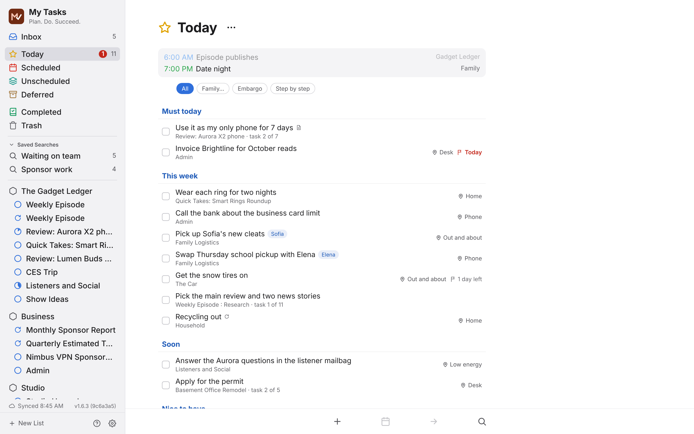

# My Tasks

**Plan. Do. Succeed.**

A better task manager that is **free**, **private** and **secure**. My Tasks gives you a calm, focused way to plan your work, on every device you own, without a subscription or an account with us.

**Website:** [mytasks.fyi](https://mytasks.fyi) · **Open the app:** [mytasks.fyi/app](https://mytasks.fyi/app/) · **Guide:** [mytasks.fyi/guide](https://mytasks.fyi/guide/)

> [!NOTE]
> **Ready for use, within its limitations.** Please read the [risks and limitations](https://mytasks.fyi/limitations/) before you rely on it.

## Why My Tasks

**Free, for good.** Every feature, on every device, at no cost. No trial, no paid tier, no limits on projects or lists. Up to 5,000 tasks in each gist, the most a gist can sync; keep several gists to go past it (see the [limitations](https://mytasks.fyi/limitations/#not-possible)). My Tasks is open source under the MIT license.

**Private by design.** There is no My Tasks server and no My Tasks account. Your tasks live on your devices and in your own GitHub account, and nowhere else. No analytics, no tracking, no ads.

**Secure.** Before your tasks leave a device, they are encrypted with a passphrase that only you know, so the copy in your GitHub account can't be read without it. GitHub can see that the gist exists, its size and when it changes, and its description, which holds the gist's name. The app doesn't store your passphrase or send it anywhere. See [Security](https://mytasks.fyi/security/) for what My Tasks can't protect against.

**On every device.** It runs in any modern browser on iPhone, iPad, Mac, Windows, Linux and Android, and installs like an app on each of them. Your tasks keep working without a connection, and your devices stay in step whenever they're online.

**Familiar.** Inbox, Today, Scheduled, areas, projects, headings and checklists work the way users expect, with familiar keyboard shortcuts where the browser allows.

## How it compares to other popular task managers

|  | **My Tasks** | **Things 3** | **Todoist** | **OmniFocus 4** |
| --- | :---: | :---: | :---: | :---: |
| **Price** | Free | $49.99 Mac, $19.99 iPad, $9.99 iPhone, one-time | Free for 5 projects; Pro $5 a month yearly, or $7 monthly | $74.99 Standard or $149.99 Pro, one-time, for all your Apple devices; or $99.99 a year |
| Open source | ✅ | — | — | — |
| Your data is end-to-end encrypted | ✅ | — ¹ | — ¹ | ✅ |
| iPhone, iPad and Mac | ✅ | ✅ | ✅ | ✅ |
| Windows, Linux, Android and the web | ✅ | — | ✅ | The web, with a subscription |
| Works offline | ✅ | ✅ | ✅ | ✅ |
| Areas, projects and headings | ✅ | ✅ | Projects and sections | Folders, projects and action groups |
| Focus on one area | ✅ | — | Through filters | ✅ Focus (Pro) |
| Checklists | ✅ | ✅ | Sub-tasks | Action groups |
| Tags | ✅ | ✅ | ✅ | ✅ |
| Priorities | ✅ 5 levels | — | ✅ 4 levels | Flags |
| Contexts | ✅ | — | — | Through tags |
| Saved searches | ✅ | — | ✅ Filters | ✅ Perspectives (Pro) |
| Sequential projects | ✅ | — | — | ✅ |
| Repeating tasks | ✅ | ✅ | ✅ | ✅ |
| Repeating projects | ✅ | ✅ | — | ✅ |
| Typed dates ("next fri") | ✅ | ✅ | ✅ | ✅ |
| Change many tasks at once | ✅ | ✅ | ✅ | ✅ |
| Import from other apps | ✅ A CSV file, and a script for Things 3 | Reminders and Todoist; OmniFocus Pro by script on a Mac | A CSV file, one project at a time | Pasted TaskPaper text, or an OmniOutliner file |
| Calendar events with your tasks | ✅ The Mac’s calendars, through a helper on the Mac | ✅ | ✅ Google or Outlook | ✅ |
| Reminders and notifications | Coming: reminders in Apple Reminders, through the helper on a Mac (Mac only for now) | ✅ | ✅ | ✅ |
| Board (Kanban) view | — | — | ✅ | — |
| Sharing with others | Limited: people who trust each other can share one gist, with the cautions on the [Limitations](https://mytasks.fyi/limitations/#sharing) page | — | ✅ | — |
| Markdown in notes | ✅ | ✅ | ✅ | — |
| Widgets, Siri and Apple Watch | — ² | ✅ | ✅ | ✅ |

¹ Things and Todoist encrypt your data on their servers, but they hold the keys, so the company could read it.

² Not possible for a web app without a server, so My Tasks leaves these out.

Comparison as of November 2026. Prices are in US dollars and can change.

## How it works

1. Open [mytasks.fyi/app](https://mytasks.fyi/app/) in your browser and install it: to your Home Screen on iPhone and iPad, to the Dock from Safari on a Mac, or with Chrome's or Edge's install button. The app shows you how.
2. Confirm you've read the [risks and limitations](https://mytasks.fyi/limitations/), connect it to your free GitHub account with a token (the app shows you how), and choose a passphrase.
3. My Tasks creates a secret, encrypted gist in your account to hold your tasks. Connect your other devices with the same token and passphrase, and they all stay in step.

Every device keeps its own working copy, so the app is fast and works without a connection. Changes are encrypted and sent to your gist a moment after you make them. You can also save a backup file of your tasks in Settings and restore it later.

## Status

My Tasks is being built in milestones, one pull request at a time. The core of the app is done: lists, projects, tags, priorities, contexts, search, drag and drop, keyboard shortcuts, themes, encrypted sync, installing as an app that works fully offline, and hosting at [mytasks.fyi](https://mytasks.fyi), with its website. See the [Roadmap](https://mytasks.fyi/roadmap/) for what's planned, and [CHANGELOG.md](CHANGELOG.md) for what has changed so far.

The version you're using is shown at the bottom of the sidebar. Click it to open the Roadmap.

## Contributing

My Tasks is open source under the [MIT license](LICENSE). To run it locally or find your way around the code, see [DEVELOPMENT.md](DEVELOPMENT.md). To host your own copy, or change it, see [Your own copy](https://mytasks.fyi/self-hosting/) on the website.

For help, ideas and news of each new milestone, join [r/mytasksfyi](https://www.reddit.com/r/mytasksfyi/) on Reddit. Report bugs in [GitHub issues](https://github.com/CyberAdvisor/MyTasks/issues). If My Tasks helps you, you can [support it on Ko-fi](https://ko-fi.com/Z8O623D716).
